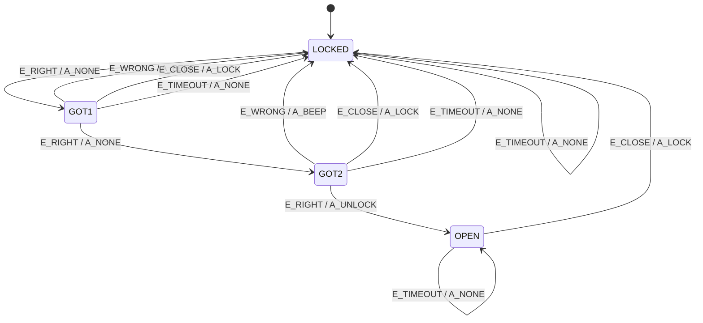

# ECE 361 Homework 05

This project implements a finite-state combination lock. The combination is
`3-1-4`, and the machine starts in `LOCKED`.

## Build and run

This project uses GNU Make. On Linux, run `make`; on Windows with MinGW, run
`mingw32-make`.

```text
make          # build the lock and all tests
make test     # run the required lock tests
make run      # run data/codes.txt through the lock
make bonus    # run only the bonus checker tests
make clean    # remove generated files
```

The main files are:

- `main.c`: reads input and prints each state transition.
- `lock.c`: implements the transition table and lock behavior.
- `lock.h`: defines the states, events, actions, and public interfaces.
- `data/codes.txt`: sample input for `make run`.
- `tests/test_lock.c`: tests the required lock FSM.
- `check.c` and `check.h`: implement the optional bonus table checker.
- `tests/test_check.c`: tests the bonus checker.
- `BONUS.md`: documents the bonus implementation and defect cases.

## State diagram



`E_TIMEOUT` is only meaningful while entering the combination, so its
transitions from `LOCKED` and `OPEN` are no-ops. Digit events do not affect an
already-open lock.

## Transition table

Each cell is `(next state, action)`. The rows and columns follow the enum
order in `lock.h`.

| Current state | `E_RIGHT` | `E_WRONG` | `E_CLOSE` | `E_TIMEOUT` |
|---|---|---|---|---|
| `LOCKED` | `GOT1, A_NONE` | `LOCKED, A_BEEP` | `LOCKED, A_NONE` | `LOCKED, A_NONE` |
| `GOT1` | `GOT2, A_NONE` | `LOCKED, A_BEEP` | `LOCKED, A_LOCK` | `LOCKED, A_NONE` |
| `GOT2` | `OPEN, A_UNLOCK` | `LOCKED, A_BEEP` | `LOCKED, A_LOCK` | `LOCKED, A_NONE` |
| `OPEN` | `OPEN, A_NONE` | `OPEN, A_NONE` | `LOCKED, A_LOCK` | `OPEN, A_NONE` |

## Bonus: FSM table checker

The bonus adds `fsm_check` in `check.c`/`check.h`:

```c
int fsm_check(const transition_t table[N_STATES][N_EVENTS],
              state_t start,
              FILE *out);
```

It reports and counts:

- table entries with `A_UNDEFINED`;
- transitions whose next state is outside the valid state range; and
- states that cannot be reached from the supplied start state.

The checker returns zero for a valid table. It does not change the lock FSM;
it validates a table supplied by the caller. The tests include one valid table
and one example for each type of error.

See [`BONUS.md`](./BONUS.md) for the full bonus explanation.

